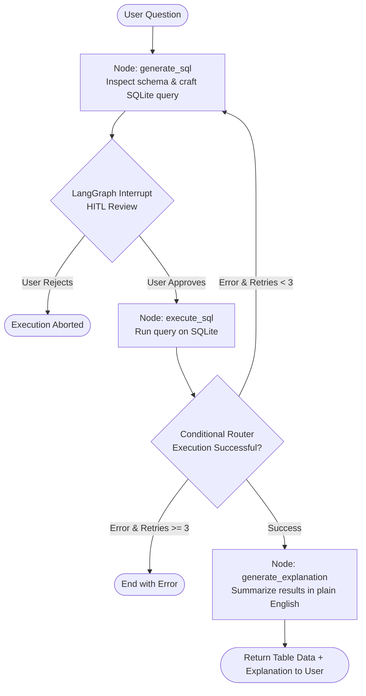

# 🤖 Text-to-SQL Agent with Human-in-the-Loop & Self-Healing

[](https://www.python.org/)
[](https://fastapi.tiangolo.com/)
[](https://langchain-ai.github.io/langgraph/)
[](https://ai.google.dev/)
[](https://nextjs.org/)
[](https://react.dev/)
[](https://tailwindcss.com/)
[](https://opensource.org/licenses/MIT)

An intelligent, full-stack **Text-to-SQL AI Agent** built using **LangGraph**, **FastAPI**, **Google Gemini 2.5 Flash**, and **Next.js 16**.

It converts natural language questions into syntactically valid SQLite queries, presents the generated SQL for **Human-in-the-Loop (HITL) review & approval**, executes queries securely, **self-heals** automatically if database errors occur, and delivers friendly plain-English explanations alongside tabular data results.

---

## 🌟 Key Features

- **🗣️ Natural Language to SQL**: Converts colloquial business questions into complex SQL queries with joins, aggregations, filters, and sorting.
- **🛡️ Human-in-the-Loop (HITL) Guardrail**: Employs LangGraph breakpoints (`interrupt_before=["execute_sql"]`) and persistent checkpoints (`MemorySaver`). Generated SQL must be reviewed and explicitly approved by the user before executing against the database.
- **🔄 Autonomous Self-Healing**: If a query encounters a database error (syntax error, missing column, etc.), the error traceback is routed back to Gemini for up to 3 automated self-correction retries.
- **📊 Schema-Aware Dynamic Introspection**: Utilizes SQLAlchemy & LangChain `SQLDatabase` to dynamically inspect tables, columns, and foreign keys from the database schema.
- **💬 Plain-English Explanations**: Translates raw tabular results into concise, direct business answers for non-technical stakeholders.
- **⚡ Modern Full-Stack UI**: Sleek dark-mode interface with real-time chat, VS Code Dark Plus SQL syntax highlighting, one-click query copy, tabular result viewer, and retry badges.
- **🔍 Observability Ready**: Built-in integration with LangSmith for agent workflow tracing, token tracking, and debugging.
- **🐳 Dockerized**: Production-ready Dockerfile for quick backend deployment.

---

## 🏗️ Architecture & Workflow

The agent's state machine is orchestrated using **LangGraph**:



---

## 📁 Repository Structure

```text
text-to-sql-agent/
├── backend/
│   ├── agent.py               # LangGraph state machine, nodes, and router
│   ├── database.py            # SQLite connection and Chinook DB downloader
│   ├── main.py                # FastAPI server & REST API endpoints
│   ├── requirements.txt       # Python dependencies
│   ├── Dockerfile             # Container definition for backend
│   ├── .env.example           # Environment variables template
│   └── chinook.db             # SQLite sample database (auto-downloaded)
├── frontend/
│   ├── src/
│   │   └── app/
│   │       ├── page.tsx       # Interactive chat UI with HITL controls
│   │       ├── layout.tsx     # Next.js root layout
│   │       └── globals.css    # Tailwind CSS v4 stylesheets
│   ├── package.json           # Node.js dependencies & scripts
│   ├── tsconfig.json          # TypeScript configuration
│   └── next.config.ts         # Next.js configuration
├── .gitignore
└── README.md
```

---

## 💽 Sample Database: Chinook

The backend connects out-of-the-box to the **Chinook Database**, a standard sample relational database representing a digital media store:
- **Tables**: `Artist`, `Album`, `Track`, `Genre`, `MediaType`, `Playlist`, `Invoice`, `InvoiceLine`, `Customer`, `Employee`.
- If `chinook.db` is not present locally, `database.py` automatically downloads it upon first startup.

---

## 🚀 Quick Start Guide

### Prerequisites

- **Python**: 3.11 or higher
- **Node.js**: 18.x or higher (and npm / pnpm)
- **Google Gemini API Key**: [Get one from Google AI Studio](https://aistudio.google.com/)

---

### 1. Backend Setup

1. **Navigate to the backend directory**:
   ```bash
   cd backend
   ```

2. **Create and activate a virtual environment**:
   - **Linux / macOS**:
     ```bash
     python3 -m venv venv
     source venv/bin/activate
     ```
   - **Windows (PowerShell)**:
     ```powershell
     python -m venv venv
     .\venv\Scripts\Activate.ps1
     ```

3. **Install dependencies**:
   ```bash
   pip install -r requirements.txt
   ```

4. **Configure environment variables**:
   Create a `.env` file in the `backend/` directory:
   ```bash
   cp .env.example .env
   ```
   Edit `.env` and add your Google Gemini API key:
   ```env
   GOOGLE_API_KEY="your-google-api-key-here"

   # Optional: LangSmith Tracing & Observability
   LANGCHAIN_TRACING_V2=true
   LANGCHAIN_ENDPOINT="https://api.smith.langchain.com"
   LANGCHAIN_API_KEY="your-langchain-api-key-here"
   LANGCHAIN_PROJECT="text-to-sql-agent"
   ```

5. **Start the FastAPI backend server**:
   ```bash
   uvicorn main:app --reload --port 8000
   ```
   The API will be available at `http://127.0.0.1:8000` (Swagger docs at `http://127.0.0.1:8000/docs`).

---

### 2. Frontend Setup

1. **Open a new terminal and navigate to the frontend directory**:
   ```bash
   cd frontend
   ```

2. **Install Node.js dependencies**:
   ```bash
   npm install
   ```

3. **Configure environment variables (optional)**:
   By default, the frontend connects to `http://127.0.0.1:8000`. To customize, create `.env.local`:
   ```env
   NEXT_PUBLIC_API_URL=http://127.0.0.1:8000
   ```

4. **Run the development server**:
   ```bash
   npm run dev
   ```

5. **Open your browser** and visit:
   ```text
   http://localhost:3000
   ```

---

### 3. Docker Deployment (Backend)

You can containerize and run the backend using Docker:

```bash
cd backend
docker build -t text-to-sql-agent-backend .
docker run -p 8000:8000 -e GOOGLE_API_KEY="your-api-key" text-to-sql-agent-backend
```

---

## 💡 Example Queries to Try

Test the agent by asking natural language questions about the Chinook media store:

- *"Which 5 artists have the most albums?"*
- *"Show me the top 10 customers by total invoice spending."*
- *"What are the top 5 best-selling genres by number of tracks sold?"*
- *"List the employees and how many customers each supports."*
- *"Find all tracks that are longer than 5 minutes and cost more than $0.99."*
- *"Which country generates the highest total revenue?"*

---

## 🔌 API Endpoints

### 1. `POST /chat`
Initiates a query, generates SQL, and halts execution for user approval.

- **Request Body**:
  ```json
  {
    "query": "Who are the top 3 artists with the most albums?",
    "thread_id": "session-unique-id"
  }
  ```
- **Response**:
  ```json
  {
    "sql_query": "SELECT Artist.Name, COUNT(Album.AlbumId) AS AlbumCount FROM Artist JOIN Album ON Artist.ArtistId = Album.ArtistId GROUP BY Artist.ArtistId ORDER BY AlbumCount DESC LIMIT 3;",
    "status": "pending_approval"
  }
  ```

---

### 2. `POST /execute`
Approves or rejects query execution, runs the query, and triggers self-healing / summary generation.

- **Request Body**:
  ```json
  {
    "thread_id": "session-unique-id",
    "approve": true
  }
  ```
- **Response**:
  ```json
  {
    "sql_query": "SELECT Artist.Name, COUNT(Album.AlbumId) AS AlbumCount...",
    "results": [
      { "Name": "Iron Maiden", "AlbumCount": 21 },
      { "Name": "Led Zeppelin", "AlbumCount": 14 },
      { "Name": "Deep Purple", "AlbumCount": 11 }
    ],
    "explanation": "The top 3 artists with the most albums are Iron Maiden (21 albums), Led Zeppelin (14 albums), and Deep Purple (11 albums).",
    "status": "completed",
    "retry_count": 0
  }
  ```

---

## 🛠️ Tech Stack Details

| Layer | Technologies |
|---|---|
| **Frontend** | [Next.js 16](https://nextjs.org/) (App Router), [React 19](https://react.dev/), [TypeScript](https://www.typescriptlang.org/), [Tailwind CSS v4](https://tailwindcss.com/), [Lucide React](https://lucide.dev/), [React Syntax Highlighter](https://github.com/react-syntax-highlighter/react-syntax-highlighter), [Axios](https://axios-http.com/) |
| **Backend** | [FastAPI](https://fastapi.tiangolo.com/), [Uvicorn](https://www.uvicorn.org/), [Pydantic](https://docs.pydantic.dev/) |
| **Agent & LLM** | [LangGraph](https://langchain-ai.github.io/langgraph/) (StateGraph & Checkpoints), [LangChain](https://www.langchain.com/), [Google Generative AI](https://ai.google.dev/) (`gemini-2.5-flash`), [LangSmith](https://smith.langchain.com/) |
| **Database** | [SQLite](https://www.sqlite.org/), [SQLAlchemy](https://www.sqlalchemy.org/), [Chinook Database](https://github.com/lerocha/chinook-database) |
| **DevOps** | [Docker](https://www.docker.com/) |

---

## 🤝 Contributing

Contributions, issues, and feature requests are welcome!
Feel free to open an issue or submit a pull request.

1. Fork the Project
2. Create your Feature Branch (`git checkout -b feature/AmazingFeature`)
3. Commit your Changes (`git commit -m 'Add some AmazingFeature'`)
4. Push to the Branch (`git push origin feature/AmazingFeature`)
5. Open a Pull Request

---

## 📄 License

This project is licensed under the MIT License - see the LICENSE file for details.
